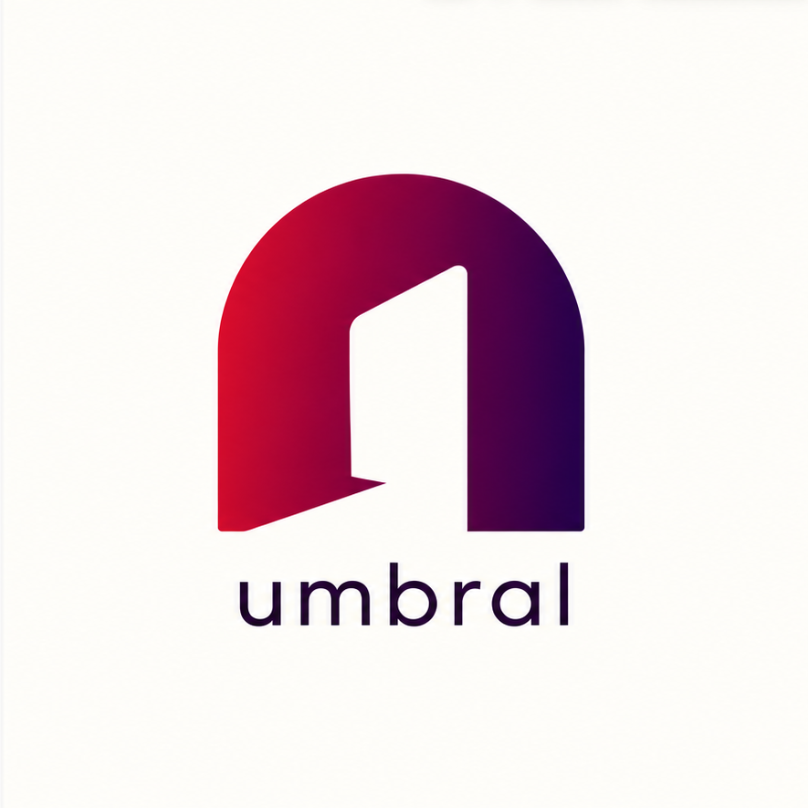

<div align="center">
  <picture>
    <source srcset="design/branding/logo-dark.png" media="(prefers-color-scheme: dark)">
    
  </picture>

  <h1>Umbral Browser</h1>

  <p>A focused, customizable browser built on Zen Browser and Firefox, with privacy-minded defaults for everyday browsing.</p>

  <p>
    <a href="LICENSE"></a>
    <a href="https://github.com/Martin08ABM/umbral-browser/issues">Issues and feedback</a>
  </p>
</div>

Umbral is an independent browser project. It brings a quieter, compact interface to the Firefox platform while keeping familiar browser features and room to shape your setup. Privacy protections can reduce some tracking; they do not make browsing anonymous.

## What’s here

- **An Umbral homepage** with a compact top address bar, bookmarks, and a clear view of browser protection status.
- **Spaces and containers** for separating browsing contexts. New tabs inherit the active tab’s container, or the last-used container in that space when there is no usable active tab.
- **uBlock Origin** distributed as the original AMO-signed extension, with its own settings, lists, and controls. Firefox installs the bundled copy for new profiles; an existing uBlock Origin installation is preserved.
- **Firefox Enhanced Tracking Protection (ETP) Strict** as the default for new profiles, with Firefox’s per-site controls and compatibility exceptions.
- **Privacy cards** for ETP-classified tracker and tracking-cookie records from the last seven UTC dates. These are Firefox ETP records, **not** ads, network requests, or uBlock Origin blocks. Private-browsing activity is excluded by Firefox’s recording path.
- **DuckDuckGo** as the default search engine, with an option to add and choose a SearXNG instance you trust. Umbral does not choose or contact an instance for you.

## Development status

Umbral is in active development. Linux is the platform currently built and functionally tested. Windows and macOS on Apple Silicon are planned; they have not yet been verified for Umbral. There are no Umbral download packages to offer yet.

## Build from source

These commands follow the scripts in [`package.json`](package.json). From a fresh checkout with Node.js and the project’s build prerequisites available:

```sh
npm ci
npm run init
npm run build
```

`npm run init` downloads the pinned browser base, imports the project sources and service data, and bootstraps the build environment. For UI-only changes, use `npm run build:ui` after initialization.

The generated browser tree lives in `engine/`. Persistent Umbral sources live in `src/`, `prefs/`, `configs/`, `locales/`, and `surfer.json`; patches under `src/**/*.patch` are applied when the engine is generated. Keep changes in those persistent sources so they survive regeneration.

For the exact ETP metric definitions and privacy boundaries, see [the homepage privacy-data notes](src/browser/extensions/newtab/umbral-privacy-data.md). For project conduct, see the [Code of Conduct](CODE_OF_CONDUCT.md).

## Credits and licenses

Umbral builds on the open-source work of the [Zen Browser project](https://github.com/zen-browser/desktop) and [Mozilla Firefox](https://www.mozilla.org/firefox/). This repository’s license is [Mozilla Public License 2.0](LICENSE). Mozilla, Firefox, Zen Browser, and their marks remain the property of their respective owners.

The bundled [uBlock Origin](https://github.com/gorhill/uBlock) extension is redistributed unmodified and retains its upstream signature, author attribution to Raymond Hill and contributors, and **GNU GPL-3.0-only** license. Its included license and bundle details are documented in [`src/browser/app/distribution/README.md`](src/browser/app/distribution/README.md). Other components retain their own source notices and licenses.
